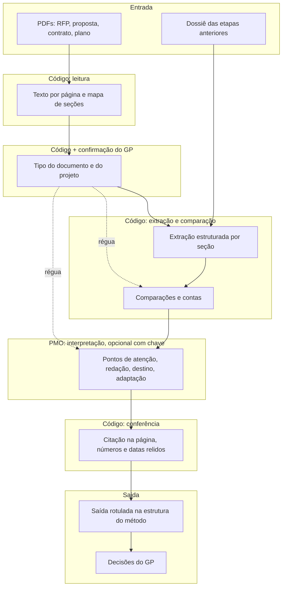
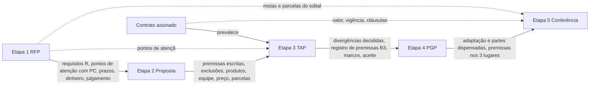

# Arquitetura da análise

A análise foi feita em seis camadas, na mesma ordem em todas as etapas. A camada 2 (tipo) e a camada 5 (conferência por código) são as que o app de hoje não tem ou faz fora de ordem.

## Dependências entre as etapas

O que cada etapa entrega à seguinte, pelo dossiê. As setas tracejadas mostram onde a análise usou um item de uma etapa anterior que não é a imediata.

## Fontes da skill PMO usadas em cada etapa

| Etapa | Referências que mudaram o resultado |
|---|---|
| 1 | `checklist.md` (sinais de aplicação das PC; CTR7 duas leituras; CTR2, CTR3); `experiencia.md` §1, §3, §4, §5, §6, §7; `licitacoes.md` §1 e §4 |
| 2 | Fichas `prop-estrategia` (.8 destino de cada brecha), `prop-sow` (.2 a .11), `prop-metodologia` (.7 campo, .8 mobilização, .10 qualidade), `prop-equipe` (.4 produtividade, .7 RACI), `prop-preco` (.3, .4, .6, .8), `prop-matriz-atendimento` (.7, .10) |
| 3 | Ficha `tap` (TAP1.2, TAP6.3, TAP9.4, TAP10.2, TAP12.2), `b03` (.6, .7, .8), `b31` |
| 4 | `pmbok7.md` (adaptação); fichas `a06`, `a07`, `a08`, `a11`, `a12`, `a16`, `b08`, `b13`, `b16`, `b17`, `b27`, `b29` (seções "Conteúdo mínimo" e "Quando dispensar") |
| 5 | `checklist.md` (três lugares); `experiencia.md` §7 (texto reaproveitado); fichas das partes do núcleo; decisões 0008 e 0009 (gravidade) |

> [!NOTE] Inferido — validar com a responsável pelo projeto
> A camada "tipo" aparece como etapa explícita nesta análise. A especificação a deixa implícita (decisão 0033 a introduz só na etapa 5). Sugere-se que ela vire um módulo comum às cinco etapas.
