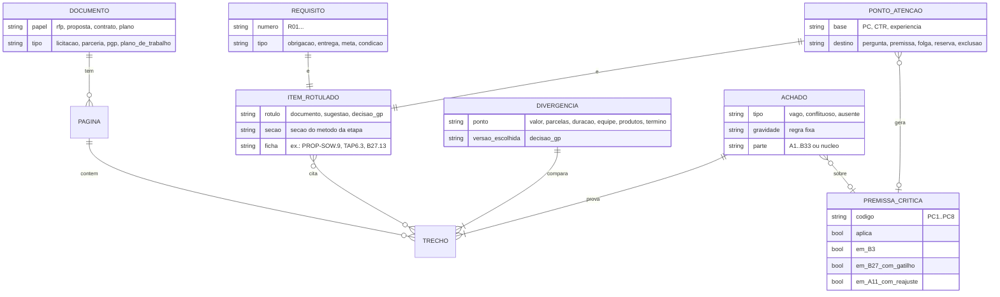

# Modelo de dados da análise

As entidades que a análise produziu e ligou. Todo item exibido é um `ITEM_ROTULADO` (Do documento, Sugestão ou Decisão do GP) com pelo menos um `TRECHO` quando é "Do documento".

## Regras de ligação observadas

- Um ponto de atenção da etapa 1 que se aplica a uma PC **gera** a premissa crítica; na etapa 2 ele recebe um destino; na etapa 3 entra no B3; na etapa 4 ganha os três lugares; na etapa 5 é conferido. O identificador da PC é o mesmo em todas as etapas.
- Uma divergência só existe entre **dois ou mais trechos** de documentos diferentes (ou de seções diferentes do mesmo documento, no caso da frase de conformidade).
- Um achado "ausente" não tem trecho do plano; tem o trecho que **exige** o item (RFP, contrato, ficha) e a lista de onde se procurou.
- "O que está em ordem" é uma lista de comparações que passaram, com os dois trechos. É o mesmo registro da comparação, com resultado "confere".
