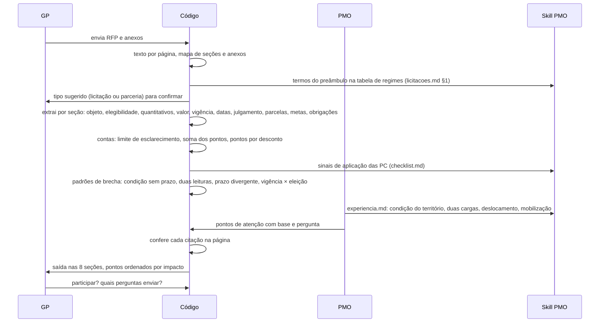
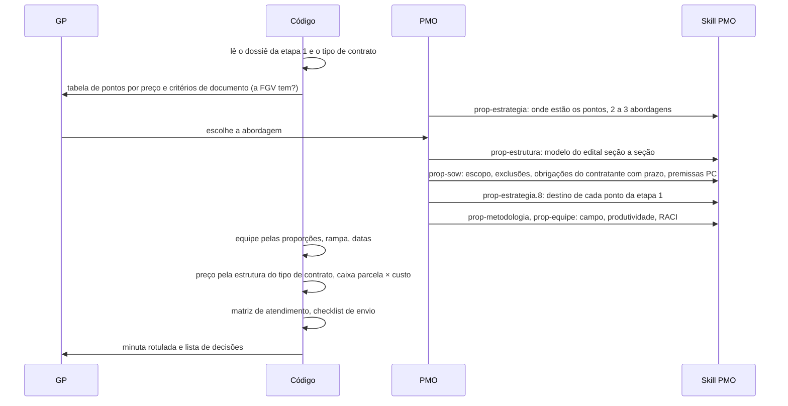
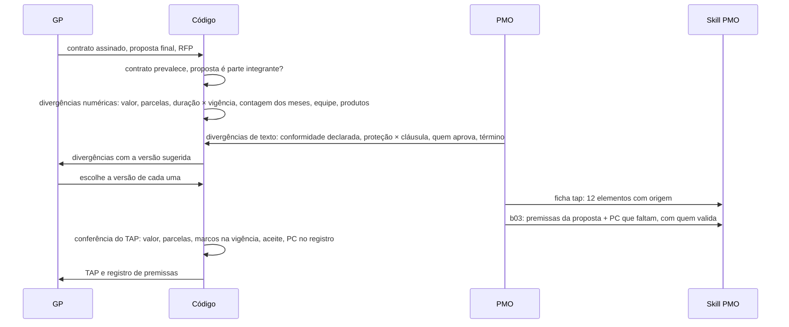
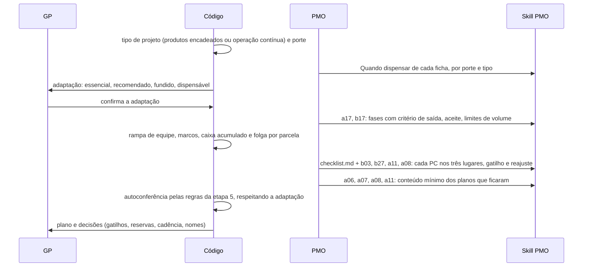
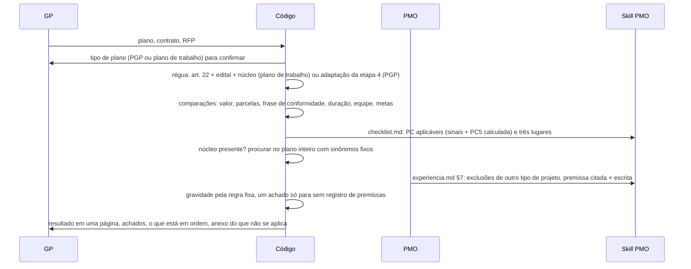

# Fluxos das cinco análises

Um diagrama por etapa, na ordem em que a análise foi feita de verdade. "Código" é o que pode ser regra determinística; "PMO" é o que exigiu interpretação com a skill.

## Etapa 1 — leitura da RFP

## Etapa 2 — proposta

## Etapa 3 — TAP

## Etapa 4 — PGP

## Etapa 5 — conferência

