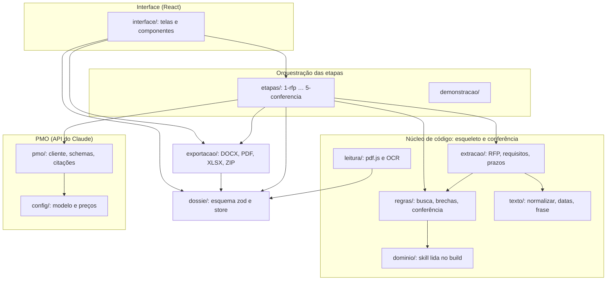

# 02 — Arquitetura

As camadas do app, quem depende de quem e as decisões estruturais que o código mostra.

## Padrão

É um **monólito de front-end em camadas**, estático, sem servidor próprio. Tudo roda na aba do navegador:

- leitura dos PDFs;
- regras;
- contas;
- montagem dos documentos.

A única saída de rede é a chamada à API do Claude, num módulo só (`src/pmo/cliente.ts`). O estado é o **dossiê**: um objeto validado por zod, que fica na memória da aba e que o GP salva como arquivo `.dossie.json`.

## Camadas

| Camada | Pastas | Responsabilidade |
|---|---|---|
| Interface | `interface/` | Telas por etapa (`telas/`), componentes reaproveitados (`componentes/`), tokens de cor e o logo (`ativos/`) |
| Orquestração | `etapas/`, `demonstracao/` | Junta leitura, extração, regras e PMO em cada etapa; guarda a decisão do GP no dossiê |
| Núcleo de código | `leitura/`, `texto/`, `extracao/`, `regras/`, `dominio/` | Funções puras sobre o texto lido: mapa, extração, busca com página e trecho, brechas, o esqueleto que vai no pedido ao PMO e a conferência do que ele devolve (decisão 0035) |
| PMO | `pmo/`, `config/` | A leitura de cada etapa: pedido à API com a skill, o esqueleto e o texto (cache), resposta em JSON validada, conferência de citações e redação, custo |
| Saída | `exportacao/` | Modelo neutro de documento (`DocumentoExportavel`) e um montador por formato |
| Estado | `dossie/` | Esquema, salvar e abrir, store |

## Decisões estruturais visíveis no código

- **Funções puras e testáveis no núcleo.** `analisarRfp` recebe os documentos lidos e a data e devolve a análise (`src/etapas/1-rfp/analisar-rfp.ts`). O resultado fica em cache por documento num `WeakMap`. As decisões do GP vivem à parte, no dossiê, ligadas ao id estável de cada item.
- **Skill como fonte única.** As fichas e o checklist das premissas críticas são importados com `?raw` no build (`src/dominio/skill.ts`). A mesma skill é a instrução do PMO e a base das regras da etapa 5.
- **Documento gerado vira documento "lido".** A proposta, o TAP e o PGP gerados na ferramenta passam pelos mesmos leitores e regras que um PDF (`src/etapas/documento-virtual.ts`). A etapa 4 roda a conferência da etapa 5 sobre o próprio plano (`src/etapas/4-pgp/autoconferencia.ts`).
- **Carregamento sob demanda.** pdf.js, Tesseract.js e os montadores DOCX, PDF, XLSX e ZIP são importados com `import()` na hora do uso (`src/leitura/navegador.ts`, `src/exportacao/exportar.ts`).
- **Rotas com hash** (`HashRouter`), porque o GitHub Pages não reescreve URLs: `/` e `/etapa/:numero` (`src/main.tsx`).
- **Segurança no build.** A Content-Security-Policy vai numa `<meta>` gerada pelo plugin do Vite. Libera conexão só com o próprio site e `api.anthropic.com` (`vite.config.ts`).

A visão resumida, com o fluxo de uma etapa e o dossiê, continua em `docs/arquitetura.md`.

## Referências no código

- `src/main.tsx`, `vite.config.ts`
- `src/etapas/1-rfp/analisar-rfp.ts`, `src/etapas/documento-virtual.ts`, `src/etapas/4-pgp/autoconferencia.ts`
- `src/dominio/skill.ts`
- `src/pmo/cliente.ts`
- `src/leitura/navegador.ts`, `src/exportacao/exportar.ts`, `src/exportacao/modelo.ts`
- `src/dossie/store.ts`, `src/dossie/esquema.ts`
