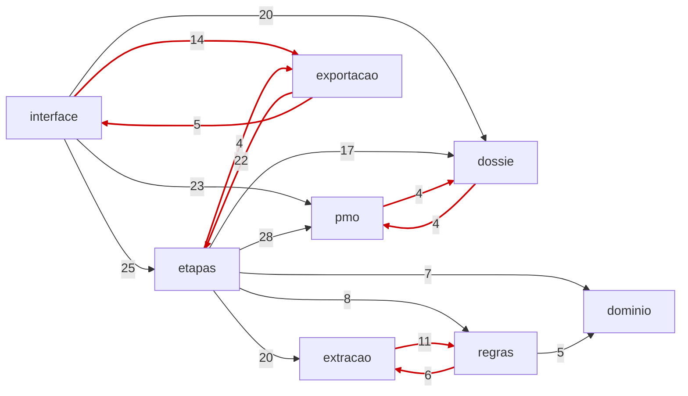

# 03 — Dependências

Quem depende de quem dentro de `src/` e quais pacotes externos o app usa.

## Grafo interno

O grafo foi calculado pelos imports relativos entre as pastas de `src/`, contando também os `import()` dinâmicos (16/11/2026). O número na aresta é a quantidade de imports.

Imports só de tipo (`import type`) somem no build e ficam de fora. Ficaram de fora também as arestas de `leitura`, `texto`, `extracao` e `config` para `dossie` que só trazem tipos.

As arestas vermelhas fecham um ciclo.

### Ciclos com código de verdade (não só tipos)

| Ciclo | Por quê | Arquivos |
|---|---|---|
| `etapas` ↔ `exportacao` | As etapas 3 e 4 transformam a proposta e o TAP gerados em documento "lido" usando os montadores de relatório. Os relatórios usam a lógica das etapas | `src/etapas/3-tap/entrada.ts`, `src/etapas/4-pgp/entrada.ts`, `src/etapas/4-pgp/autoconferencia.ts`, `src/exportacao/relatorio-*.ts` |
| `extracao` ↔ `regras` | A extração usa a busca normalizada de `regras/busca.ts`. As regras usam o mapa e a localização da RFP | `src/regras/busca.ts`, `src/extracao/rfp/localizar.ts`, `src/regras/brechas-rfp.ts` |
| `exportacao` ↔ `interface` | Os montadores usam os tokens de cor e o logo da interface. A interface chama os montadores | `src/interface/tokens.ts`, `src/interface/ativos/` |
| `dossie` ↔ `pmo` | O esquema do dossiê guarda as respostas do PMO validadas pelos schemas de `pmo/schemas/`. O PMO lê o dossiê | `src/dossie/esquema.ts`, `src/pmo/schemas/` |

Os ciclos não quebram a execução: nenhum módulo usa o outro na carga. Mas eles atrapalham separar as camadas. Os pontos de atenção estão em `09-pontos-de-atencao.md`.

## Pacotes externos (produção)

| Pacote | Versão | Para quê | Onde |
|---|---|---|---|
| `react`, `react-dom` | 19.2.9 | Interface | `src/interface/` |
| `react-router-dom` | 7.18.5 | Rotas com hash | `src/main.tsx` |
| `zustand` | 5.0.16 | Store do dossiê | `src/dossie/store.ts` |
| `zod` | 4.6.7 | Esquema do dossiê e saída estruturada do PMO | `src/dossie/esquema.ts`, `src/pmo/schemas/` |
| `pdfjs-dist` | 6.4.299 | Texto do PDF por página | `src/leitura/navegador.ts` |
| `tesseract.js` | 7.0.0 | OCR em português, num worker | `src/leitura/navegador.ts` |
| `@anthropic-ai/sdk` | 1.6.0 | Chamada à API do Claude (streaming, saída estruturada com zod) | `src/pmo/cliente.ts` |
| `docx` | 9.15.0 | Exportação DOCX | `src/exportacao/docx.ts` |
| `pdfmake` | 0.3.13 | Exportação PDF, com a fonte Arimo | `src/exportacao/pdf.ts` |
| `exceljs` | 4.4.0 | Exportação XLSX | `src/exportacao/xlsx.ts` |
| `fflate` | 0.8.2 | Pacote .zip do PGP | `src/exportacao/exportar.ts` |

As versões são fixas, sem `^` (`package.json`).

## Pacotes de desenvolvimento

| Grupo | Pacotes |
|---|---|
| Build e tipos | `vite` 8.3.5, `@vitejs/plugin-react`, `typescript` 6.0.3, `@types/*` |
| Testes | `vitest` 4.1.12, `@playwright/test` 1.64.1, `@testing-library/react` e `dom`, `jsdom` |
| Qualidade | `eslint` 10, `typescript-eslint`, `eslint-plugin-react-hooks`, `prettier` 3.9 |
| Ativos servidos pelo site | `@tesseract.js-data/por` (dados do português), `@expo-google-fonts/arimo` (fonte do PDF) |

Os ativos são copiados de `node_modules` para `public/vendor/` antes de cada `dev` e `build` (`scripts/copiar-ativos-leitura.mjs`), porque a CSP não permite CDN.

## Referências no código

- `package.json`, `scripts/copiar-ativos-leitura.mjs`
- `src/` (imports entre pastas)
- `src/etapas/3-tap/entrada.ts`, `src/etapas/4-pgp/entrada.ts`, `src/etapas/4-pgp/autoconferencia.ts`
- `src/regras/busca.ts`, `src/extracao/rfp/localizar.ts`
- `src/interface/tokens.ts`, `src/dossie/esquema.ts`, `src/pmo/schemas/`
