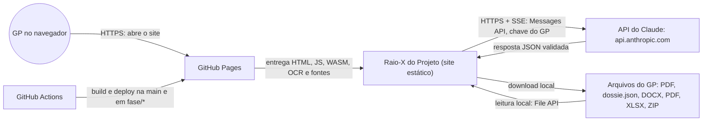

# 04 — Integrações

Com que sistemas de fora o app conversa, por qual protocolo e com que proteção.

O app tem **uma integração em tempo de execução**: a API do Claude. O resto é publicação (GitHub Pages e Actions) e arquivos que o próprio GP abre e salva.

## API do Claude (Anthropic)

| Item | Como está | Onde |
|---|---|---|
| Direção | Saída: do navegador para `api.anthropic.com` | `src/pmo/cliente.ts` |
| Protocolo | HTTPS, Messages API em streaming (`beta.messages.stream`), com saída estruturada (`zodOutputFormat`) | `chamarPmo` em `src/pmo/cliente.ts` |
| Autenticação | Chave da API do próprio GP, informada na tela e guardada só no `sessionStorage` da aba | `src/pmo/chave.ts` |
| SDK | `@anthropic-ai/sdk` com `dangerouslyAllowBrowser: true`, 3 novas tentativas e tempo limite de 15 minutos | `criarCliente` em `src/pmo/cliente.ts` |
| Cache | A skill (`system`) e o texto dos documentos vão com `cache_control: ephemeral` | `src/pmo/cliente.ts`, `src/pmo/montagem.ts` |
| Modelo e esforço | Opus 5.5 padrão provisório, Sonnet 5.5 para comparação; esforço e limite de saída por passo | `src/config/modelo.ts` (decisão 0002) |
| Reserva em recusa | Beta `server-side-fallback-2026-07-01` com `fallbacks: "default"` | `src/pmo/cliente.ts` |
| Erros | Traduzidos para o português, cada um com o que fazer; a chave é apagada das mensagens (`semChave`) | `traduzirErro` em `src/pmo/cliente.ts` |
| Custo | Estimado antes (tokens × preços) e registrado depois, no dossiê (`UsoPmo`) | `src/pmo/custo.ts`, `src/config/precos.ts` |
| Quem chama | A leitura do PMO em todas as etapas (decisão 0035): etapa 1 (`src/etapas/1-rfp/leitura-pmo.ts`), etapas 2, 3 e 4 (`src/etapas/*/pedidos.ts`) e etapa 5 (`src/etapas/5-conferencia/leitura-pmo.ts`). O passo "teste" só valida a chave | ver a coluna anterior |

Sem chave, nenhuma etapa analisa (decisão 0037): a tela oferece conectar ou ver a demonstração. O **modo demonstração** troca a chamada pelas respostas gravadas em `tests/fixtures/gerados/*-oei/` (todas as etapas; na 5, com um plano inventado), validadas pelos mesmos schemas (`src/demonstracao/`, decisão 0027).

## GitHub Pages e GitHub Actions

| Item | Como está | Onde |
|---|---|---|
| Hospedagem | Site estático em `https://izacxll.github.io/raio-x-do-projeto/` (base `/raio-x-do-projeto/` no build) | `vite.config.ts` |
| Publicação | A cada push na `main` e em `fase/*` (prévia para teste da responsável) | `.github/workflows/publicar.yml` (decisão 0018) |
| Verificação | Em todo pull request e na `main`: repositório público, lint, formato, testes, build e fumaça no Chromium | `.github/workflows/ci.yml` |

## Arquivos do GP (sem servidor)

- **Entrada:** PDFs lidos no navegador; o dossiê `.dossie.json`, aberto com `FileReader` e validado por zod (`src/dossie/arquivo.ts`).
- **Saída:** downloads gerados no navegador: DOCX, PDF, XLSX, ZIP, SVG e o dossiê (`src/exportacao/exportar.ts`).
- Nada é gravado em servidor. O dossiê nunca guarda a chave: o esquema não tem campo para ela.

## O que não há

- Banco de dados, back-end próprio, autenticação de usuário, filas, webhooks ou e-mail.
- CDN em produção: os ativos do OCR, do pdf.js e as fontes são servidos pelo próprio site.

## Referências no código

- `src/pmo/cliente.ts`, `src/pmo/chave.ts`, `src/pmo/montagem.ts`, `src/pmo/custo.ts`
- `src/config/modelo.ts`, `src/config/precos.ts`
- `src/demonstracao/demonstracao.ts`
- `src/dossie/arquivo.ts`, `src/exportacao/exportar.ts`
- `vite.config.ts`, `.github/workflows/ci.yml`, `.github/workflows/publicar.yml`
