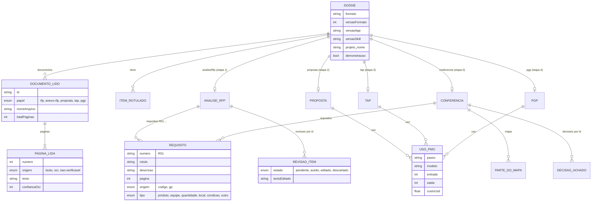

# 05 — Modelo de dados

O dossiê é o único modelo persistente do app. O núcleo dele está aqui.

O dossiê é um JSON (`<projeto>.dossie.json`) validado por zod. Ele guarda:

- o texto de cada documento lido (nunca o PDF);
- o que cada etapa produziu;
- o que o GP decidiu.

Não há banco de dados. O dossiê fica na memória da aba (`src/dossie/store.ts`) e é salvo e aberto pelo GP (`src/dossie/arquivo.ts`).

## Entidades

| Entidade | O que guarda | Esquema |
|---|---|---|
| `Dossie` | Formato e versão (para migrar), versões do app e da skill, nome do projeto, marca de demonstração | `Dossie` |
| `DocumentoLido` | Cada PDF lido, com o papel e as páginas | `DocumentoLido` |
| `PaginaLida` | Texto da página e de onde veio: texto do PDF, OCR (com a confiança) ou não verificável (com o motivo) | `PaginaLida` |
| `ItemRotulado` | Item genérico com rótulo, estado e origem (documento, página e trecho) | `ItemRotulado` |
| `AnaliseRfpDossie` | O que fica da etapa 1: os requisitos numerados, o próximo número, as revisões por id de item e a decisão de participar | `AnaliseRfpDossie` |
| `PropostaDossie` | Respostas do PMO (estratégia, conteúdo, EAP), abordagem escolhida, premissas críticas, revisões, parâmetros do GP (valor-hora, despesas, preço final) e o uso da API | `PropostaDossie` |
| `TapDossie` | Respostas do PMO (TAP, premissas), divergências RFP × proposta decididas pelo GP, decisões (GP, patrocinador) e o uso | `TapDossie` |
| `PgpDossie` | As seis respostas do PMO, as partes a gerar, a abordagem, os parâmetros e o uso | `PgpDossie` |
| `Conferencia` | Características do projeto, mapa do PGP confirmado, premissas aplicáveis, requisitos, decisão em cada achado e a leitura do PMO | `Conferencia` |

## Regras de identidade

- A análise da RFP **não** é guardada: ela é refeita a partir do texto. Só as decisões do GP ficam, ligadas ao **id estável** de cada item (`prazos:certame:…`, `habilitacao:fgts`…). Por isso mudar a forma de um id apaga a revisão anterior daquele item (`src/etapas/1-rfp/revisao.ts`).
- Os **números R** dos requisitos são fixados no dossiê quando o GP clica em "Analisar a RFP". Requisito novo ganha o próximo número; o descartado não volta (`proximoRequisito`).
- Respostas do PMO são guardadas com o modelo e a data (`RespostaGuardada`). Assim um dossiê aberto depois não precisa chamar a API de novo.

## O que o dossiê nunca guarda

- A chave da API: o esquema não tem campo para ela, e o que não está no esquema é descartado ao salvar e ao abrir.
- O arquivo PDF: só o texto das páginas.

## Referências no código

- `src/dossie/esquema.ts` (todos os esquemas citados)
- `src/dossie/arquivo.ts`, `src/dossie/store.ts`
- `src/etapas/1-rfp/revisao.ts`
- `src/pmo/schemas/`
