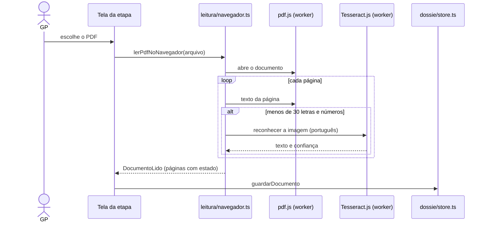
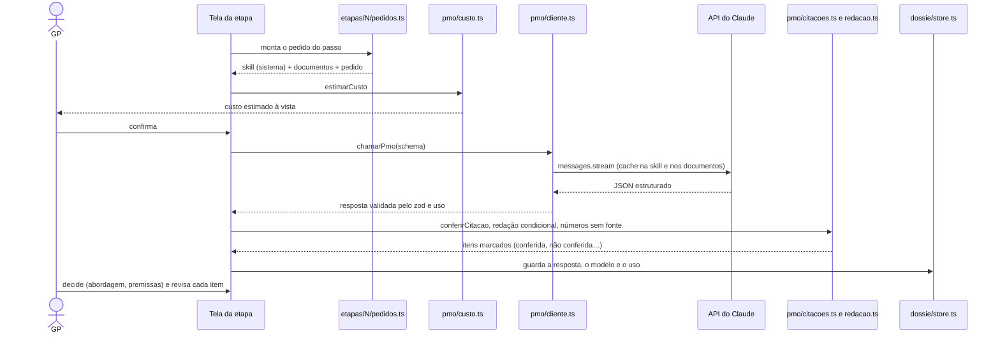
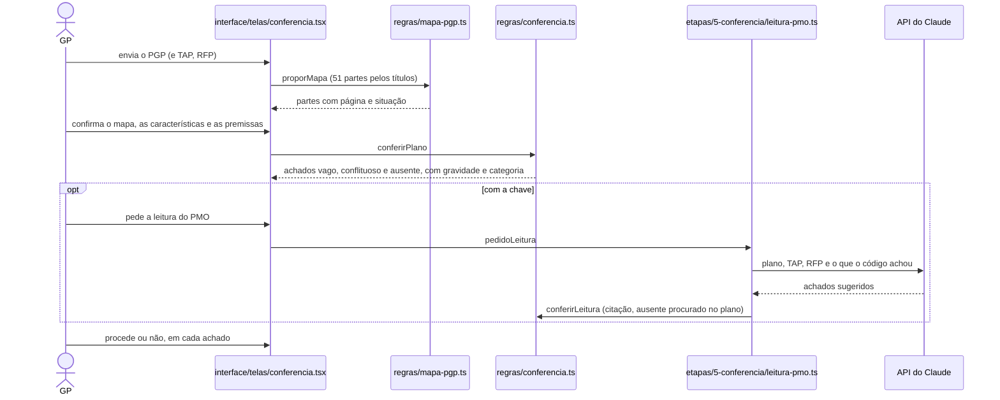
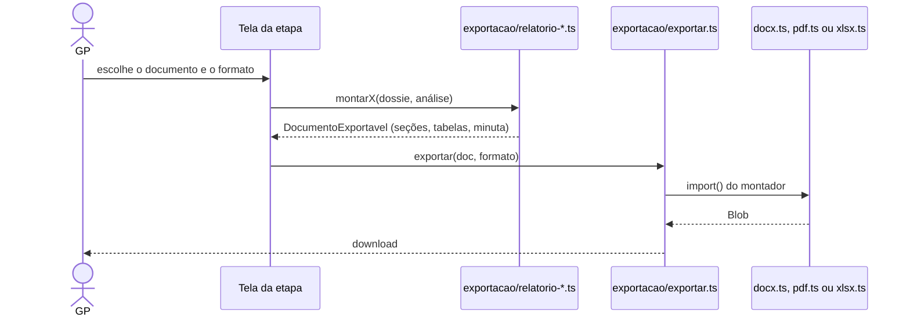

# 06 — Fluxos críticos

Os cinco caminhos que mais pesam no app, de ponta a ponta, com as funções que cada passo chama.

## 1. Leitura de um PDF

A página com menos de 30 letras e números vai para o OCR. Cada página sai com um de três estados: texto, OCR ou não verificável (decisão 0019).



## 2. Etapa 1 — leitura da RFP (o código monta o esqueleto; o PMO lê; o código confere)

A análise é pura e refeita do texto; o que fica no dossiê são os números R, a leitura do PMO (quando pedida) e as decisões do GP (decisões 0035 e 0036).

```mermaid
sequenceDiagram
  actor GP
  participant Tela as interface/telas/analise-rfp.tsx
  participant A as etapas/1-rfp/analisar-rfp.ts
  participant L as etapas/1-rfp/leitura.ts
  participant P as etapas/1-rfp/leitura-pmo.ts
  participant API as API do Claude
  participant Store as dossie/store.ts
  GP->>Tela: Analisar a RFP
  Tela->>A: analisarRfp(documentos, hoje)
  A-->>Tela: itens, requisitos, obrigações, dinheiro, pontos de atenção
  Tela->>L: montarLeituraRfp (8 seções do método)
  L-->>Tela: esqueleto ("leitura parcial por código")
  Tela->>Store: guardarAnaliseRfp (R01… fixos, revisões)
  opt com a chave
    GP->>Tela: Pedir ao PMO (custo à vista)
    Tela->>API: método da etapa 1 + esqueleto + texto da RFP
    API-->>Tela: leitura nas 8 seções (JSON)
    Tela->>P: conferirLeituraRfp (citação, número, R, conta do PMO)
    P-->>Tela: itens do PMO como Sugestão, com as travas
  end
  GP->>Tela: aceita, edita ou descarta; inclui R a partir do PMO
  GP->>Tela: exporta (DOCX, PDF, XLSX)
```

A parceria da Lei 13.019 é reconhecida pela abertura do documento. Com ela, o que é só de licitação sai como "não se aplica a esta modalidade" (`src/extracao/rfp/parceria.ts`, decisão 0031).

## 3. Passo do PMO (etapas 2, 3 e 4; o mesmo desenho das etapas 1 e 5)



As contas ficam com o código:

- cronograma PERT e caminho crítico (`src/etapas/2-proposta/cronograma.ts`);
- preço (`preco.ts`);
- custos e marcos do PGP (`src/etapas/4-pgp/calculos.ts`).

## 4. Etapa 5 — conferência do plano (a leitura do PMO é a principal; sem chave, só o código)



## 5. Exportação



O cabeçalho de minuta fica enquanto houver item pendente. No PDF, as colunas ganham a largura da palavra mais longa, e a página vai para paisagem quando as tabelas não cabem (`src/exportacao/larguras.ts`).

## Referências no código

- `src/leitura/navegador.ts`, `src/leitura/ler-documento.ts`
- `src/etapas/1-rfp/analisar-rfp.ts`, `src/extracao/rfp/`, `src/regras/brechas-rfp.ts`, `src/extracao/rfp/parceria.ts`
- `src/etapas/2-proposta/pedidos.ts`, `src/pmo/custo.ts`, `src/pmo/cliente.ts`, `src/pmo/citacoes.ts`, `src/pmo/redacao.ts`
- `src/etapas/2-proposta/cronograma.ts`, `src/etapas/2-proposta/preco.ts`, `src/etapas/4-pgp/calculos.ts`
- `src/regras/mapa-pgp.ts`, `src/regras/conferencia.ts`, `src/etapas/5-conferencia/leitura-pmo.ts`
- `src/exportacao/exportar.ts`, `src/exportacao/relatorio-rfp.ts`, `src/exportacao/larguras.ts`
